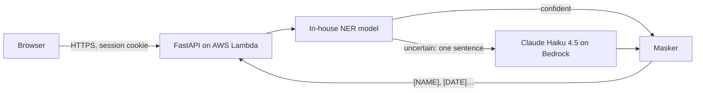

# clinical-deid-es

Final project (TFM) of the Master's in AI-Assisted Development (BIG school).

A web tool that removes personal data from a Spanish clinical note before it is used with a
third-party LLM. An in-house model (clinical RoBERTa fine-tuned on MEDDOCAN) detects personal data;
only uncertain cases are sent to an LLM, and only the affected sentence.

## Description

Clinical notes are full of personal data (names, dates, places, record numbers, phone numbers…).
Before a note can be pasted into a general-purpose LLM, that data has to go. Sending the whole note
to an LLM to clean it would defeat the purpose, and rule-based tools miss too much.

This project uses a **cascade**:

1. A fine-tuned token-classification model (`BSC-LT/roberta-base-biomedical-clinical-es` trained
   on MEDDOCAN) runs inside the service and finds the personal data in the note.
2. Entities it is unsure about (confidence below 0.96, ADR-0009) are checked by an LLM
   (Claude Haiku 4.5 on Amazon Bedrock, EU profile). **Only the sentence that contains the
   entity** is sent, at most 8 sentences per note, and never the whole document.
3. Every entity is replaced by its category, e.g. `[NAME]`, `[DATE]`, `[LOCATION]`. If the LLM
   fails or answers out of schema, the entity is masked anyway (fail-safe).



Specs: [requirements](specs/requirements.md) · [design](specs/design.md) ·
[tasks](specs/tasks.md) · [architecture decisions](docs/adr/).

## Tech stack

Python 3.12 · FastAPI · Hugging Face Transformers + PyTorch (CPU) · Amazon Bedrock
(Claude Haiku 4.5) · AWS Lambda (container image, `eu-west-1`) with a Function URL · Amazon ECR ·
Docker · GitHub Actions (CI, and CD with OIDC, no stored AWS keys) · Hugging Face Hub · Google
Colab (training) · uv · pytest · ruff. Details in [design](specs/design.md).

## Installation and running

Requirements: Python 3.12 and [uv](https://docs.astral.sh/uv/). Tested on Windows 10 and in the
CI's Ubuntu runner; no GPU needed.

```bash
git clone https://github.com/agustinroviraquezada/clinical-deid-es.git
cd clinical-deid-es
uv sync
uv run pytest          # tests use fakes: no network, no model download, no AWS
uv run ruff check .
```

Run the web tool locally:

```bash
# 1. Download the model (public, ~500 MB) to models/, which git ignores.
uvx --from huggingface_hub hf download ahrovira/clinical-deid-es-meddocan --local-dir ./models/meddocan

# 2. Create .env with a demo password (stored only as an argon2 hash) and the model path.
uv run python scripts/make_env.py --model-path ./models/meddocan

# 3. Start the API and open http://localhost:8000
uv run uvicorn clinical_deid.api.app:app --reload --port 8000 --env-file .env
```

The LLM step is off by default (`LLM_ENABLED=false`): uncertain entities are then masked
directly. Turning it on needs AWS credentials with Bedrock access, see
[deployment §8](docs/deployment.md).

Deployment to AWS (ECR, Lambda, OIDC role, secrets) is a step-by-step runbook in
[docs/deployment.md](docs/deployment.md). Every push to `main` builds the image and deploys it
([deploy.yml](.github/workflows/deploy.yml)). Training runs on Colab:
[notebooks/](notebooks/) clone the repository and call [modeling/](modeling/).

## Project structure

```
.claude/        Claude Code configuration: permissions, rules and skills
.devcontainer/  Development environment (Codespaces; not verified, development is local)
.github/        CI (tests, lint) and CD (build image, deploy to Lambda) workflows
config/         Pinned Hugging Face model revision used by the deployment
docs/           Feasibility report (frozen), ADRs, deployment runbook, security review, hours log
infra/          IAM policies for the AWS deployment
modeling/       Offline code: data preparation, training, evaluation, publishing (never deployed)
notebooks/      Colab notebooks (thin: they import modeling/)
scripts/        GitHub backlog, hours log, local .env and password hash helpers
specs/          Spec Driven Development: requirements, design and tasks
src/            Application: domain, cascade, adapters (Hugging Face, Bedrock), API and web page
tests/          Tests (pytest)
Dockerfile      AWS Lambda container image
AGENTS.md       Instructions for coding agents
```

## Main features

- **De-identify tab:** paste a Spanish clinical note (up to 10,000 characters) or load one of
  three MEDDOCAN examples, and get the masked text with every placeholder highlighted.
- **8 grouped categories:** NAME, DATE, LOCATION, ID, CONTACT, AGE, PROFESSION, OTHER, mapped
  from the 22 MEDDOCAN types.
- **Cascade with minimal fragments:** only uncertain sentences reach the LLM; its answer is
  schema-validated, and any failure masks the entity.
- **Comparison tab:** precomputed results of model only, LLM only and cascade on the MEDDOCAN test
  set (recall, precision, F1, latency, cost), overall and per category.
- **Privacy by design:** the note is never stored and never written to logs, only metadata
  (lengths, counts, timings).
- **Security:** demo login (argon2 hash, signed `HttpOnly` cookie, 5 attempts per 15 minutes),
  strict security headers and CSP, input limits, LLM call cap and time budget. See the
  [security review](docs/security-review.md).

## Results

MEDDOCAN test set (250 documents, 5,661 entities). Full reports in
[src/clinical_deid/api/report/](src/clinical_deid/api/report/).

| Model only | Recall | Precision | F1 |
| --- | --- | --- | --- |
| BIO token level (seqeval, the usual MEDDOCAN metric) | 0.974 | 0.965 | 0.969 |
| Character level (strict span + category, what the product masks) | 0.896 | 0.881 | 0.888 |
| Five hand-annotated synthetic notes in other styles (character level) | 0.679 | 0.731 | 0.704 |

- Latency on Lambda (2,048 MB): about 0.1 s per warm request inside Lambda, about 1.2 s seen from
  the client; a cold start takes about 9 s ([deployment §7.5](docs/deployment.md)).
- Cost of the model-only configuration: no per-call cost (it runs inside Lambda).
- LLM only and cascade: **pending**. Bedrock access is still blocked at AWS account level
  (support case open), so those two rows are empty for now; the code and the evaluation scripts
  are ready ([compare.py](modeling/evaluation/compare.py)).

## Limitations

- **Domain:** MEDDOCAN consists of clinical case reports with synthetic personal data. On real
  notes performance will likely be lower; on five synthetic notes in other styles, F1 drops to
  0.70.
- **Character-level recall** is 0.896, just below the 0.90 target, because span boundaries are
  sometimes off by a few characters. Identifiers (ID, recall 0.719) and professions (0.778) are
  the weakest categories. Accepted on 25 Nov 2026 ([requirements §9](specs/requirements.md)).
- **LLM step not live:** Bedrock is blocked for the AWS account, so the deployed tool runs model
  only, with uncertain entities masked directly, and the cascade has not been measured yet.
- **Third party:** when the LLM step is on, an uncertain sentence leaves the service towards
  Bedrock (EU profile, no data retention by the provider). Mitigated by sending one sentence at a
  time.
- **Abuse protection:** Lambda reserved concurrency could not be set (account quota of 10); the
  login, the attempt limit and the AWS Budgets alerts are the remaining barriers.
- **Not a certified system:** do not use it on real patient data.

## Test access

- URL: see [Links](#links)
- Username: `demo`
- Password: shared privately with the evaluator, not published in this public repository
  ([ADR-0012](docs/adr/0012-demo-password-shared-privately.md))

## Links

- Deployment: <https://kr4wgpmvqlswvvyauj7tazz5tu0sayjq.lambda-url.eu-west-1.on.aws/> (sign in with the test access above)
- Model on the Hugging Face Hub:
  [ahrovira/clinical-deid-es-meddocan](https://huggingface.co/ahrovira/clinical-deid-es-meddocan)
- Slides: added in T5.2
- Video: added in T5.3

## Data and attribution

Trained and evaluated on the **MEDDOCAN** corpus (Barcelona Supercomputing Center, CNIO and Hospital
12 de Octubre; Plan TL), licensed CC BY 4.0. Marimon et al., *Automatic De-identification of Medical
Texts in Spanish: the MEDDOCAN Track, Corpus, Guidelines, Methods and Evaluation of Results*,
IberLEF@SEPLN 2019, pp. 618–638. [doi:10.5281/zenodo.4279323](https://doi.org/10.5281/zenodo.4279323)
The corpus is not redistributed here: it is downloaded by script. The three web examples are
MEDDOCAN test documents.

Base model: [`BSC-LT/roberta-base-biomedical-clinical-es`](https://huggingface.co/BSC-LT/roberta-base-biomedical-clinical-es) (Apache-2.0).

## Licence

Code and fine-tuned model under the [Apache License 2.0](LICENSE). Third-party attributions in
[NOTICE](NOTICE).

## Disclaimer

Academic project. Not a certified system for real health data.
