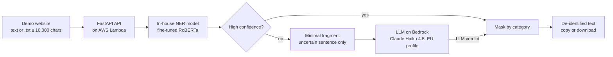
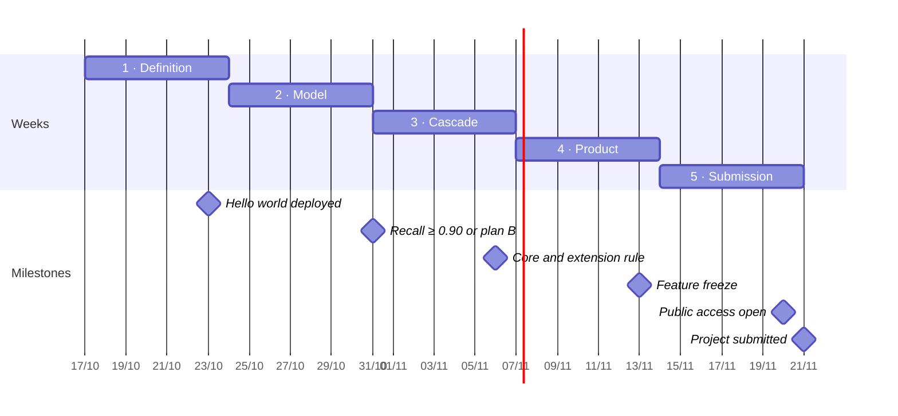

> **Frozen document (18 Oct 2026).** Feasibility report
> It is not updated: new decisions go to `docs/adr/` and the current scope lives in `specs/requirements.md`.

# Feasibility report

17–18 Oct 2026 · Agustín Rovira

## Document status

| Field | Value |
| --- | --- |
| Week | 1 of 5 · Definition |
| Closed rounds | All 8: goal, data, model, LLM, deployment, security, constraints and plan |
| Status | Ready for the scope document (`specs/requirements.md`) |
| Due date | 23 Nov 2026 (DECIDED, firm); submission planned for 21 Nov |
| Hours budget | 60 h ceiling if needed; hard limit of 65 h (DECIDED) |
| Money budget | €50 in total, reviewable during the project (DECIDED) |
| Deployment | AWS Lambda with a container image in Ireland, eu-west-1 (DECIDED) |
| Verdict | Feasible: the MVP (about 55 planned hours) fits within the 60 h ceiling; the JSON extension depends on the 6 Nov checkpoint |

Status legend:

- **DECIDED**: decided by the author; only changes if he reopens it.
- **PROPOSED**: technical recommendation pending validation.
- **PENDING**: not decided yet; has an assigned moment to decide.

## Project description

A public web tool that de-identifies a Spanish clinical note before it is used with a third-party LLM (for example, Claude). Working title: *Clinical NLP pipeline with privacy by design: hybrid model/LLM de-identification and structuring of Spanish notes*.

**Problem.** Before clinical notes can be used for research or with LLMs, the patient's personal data must be removed. Doing it by hand is slow, and sending an un-de-identified note to an external LLM exposes health data.

**Target user (DECIDED).** A researcher or individual user who needs to de-identify one document at a time, not a batch pipeline.

**Use case (DECIDED).** The user pastes text or uploads a .txt file, receives the text with personal data masked by category, and copies or downloads it to use in another tool. Use is at the user's own risk, with a visible notice.

**Solution (DECIDED).** A two-level cascade:

1. An in-house fine-tuned model (Spanish clinical RoBERTa trained on MEDDOCAN) detects and masks personal data quickly and cheaply.
2. Only low-confidence detections are sent to an LLM, and only as a **minimal fragment** (the sentence of the uncertain case), never the whole document.

**Centrepiece of the presentation.** The comparison of three configurations (model only, LLM only and cascade) on recall, cost per document and latency, computed offline and shown on the website as precomputed results.

## Goal, hypothesis and success criteria

The goal is a useful, deployed MVP that a real user can use; the technical hypothesis justifies the design, it does not replace it.

**Goal (DECIDED).** Deliver a usable tool to de-identify a Spanish clinical document, deployed at a public URL, that demonstrates the full cycle: data, model, evaluation, LLM, API, container, CI/CD and deployment.

**Technical hypothesis (DECIDED, option B).** The cascade improves the model's recall on hard entities at a bounded extra cost. A negative result is documented as a finding: it explains when adding an LLM is not worth it.

**Minimum definition of done (DECIDED).** Product requirements, not research goals:

- [ ] A user uploads a document and receives the de-identified text, which they can copy or download.
- [ ] Model recall is at least 0.90 on the MEDDOCAN test set.
- [ ] Response time is under 10 s in the demo, excluding the first call after a period of inactivity (cold start).
- [ ] The interface shows a visible privacy notice and enforces a size limit.

Anything beyond this is iteration.

**Metrics (DECIDED).**

| Metric | Role | Threshold |
| --- | --- | --- |
| Recall (span + type) | Primary: a leaked personal data item is the worst error | ≥ 0.90 (model only) |
| Precision | Minimum constraint | ≥ 0.85 |
| F1 | Secondary, comparable with the literature | No threshold |
| Latency per document | Product requirement | < 10 s in the demo (excluding cold start) |
| Cost per document | Comparison across configurations | Within the €50 total budget |

Quality metrics are reported at two granularities: overall and per the product's 6–8 grouped categories.

## Scope

The MVP is the de-identification cascade served as a website with an API and deployed on AWS; JSON structuring only enters if the core is finished in week 4.

**In the MVP**

| Item | Detail | Status |
| --- | --- | --- |
| Cascade de-identifier | Fine-tuned model + LLM only for low-confidence detections | DECIDED |
| Minimal LLM input | Only the sentence of the uncertain case, never the document | DECIDED |
| Input | Pasted text or .txt file, one document per request, at most about 10,000 characters | DECIDED |
| Output | Text with personal data masked by category (6–8 categories), to copy or download | DECIDED |
| Comparison | Offline report of the 3 configurations + a website tab with precomputed results on the examples | DECIDED |
| Demo examples | MEDDOCAN test cases + 5–10 synthetic notes in a different style, generated with an LLM and reviewed by hand | DECIDED |
| Privacy notice | Visible in the interface; use at the user's own risk | DECIDED |
| Deployment | Container on AWS with a public URL and CI/CD from GitHub | DECIDED: AWS Lambda with a container image in eu-west-1 |
| Interface | Simple website connected to an API | DECIDED: HTML + JavaScript served by FastAPI, with a demo login |

**Optional extension (week 4, only with the core finished)**

- JSON structuring (drugs and diagnoses) of the already de-identified text, evaluated on PharmaCoNER. Only enters if on 6 Nov the cascade is deployed and evaluated and no more than 36 h have been spent; otherwise it appears as future work.
- On-demand live comparison mode, with a strict usage limit.
- API Gateway in front of Lambda for per-route and burst limits.
- Trying a second base model, since it is configurable.

**Out of scope**

- Real patient data and any non-public data, code or knowledge.
- Normalisation to ontologies (SNOMED CT, ICD-10).
- Other languages.
- PDF and .docx.
- Batch processing (more than one document per request).
- Running the three configurations live on every upload.
- Self-hosted LLM.
- Hand-annotated out-of-domain test set: domain shift is accepted as a documented limitation.
- The LLM looking for entities the model did not detect.
- User management: only one demo account exists (no sign-up, no Cognito).
- Gradio and any always-on server.
- Keeping the tool online after the grade is published.

## Data

The core is trained and evaluated on MEDDOCAN, a public corpus licensed CC BY 4.0, which allows reuse with attribution to its authors ([Zenodo](https://zenodo.org/records/4279323)).

| Field | Verified value | Source |
| --- | --- | --- |
| Authors | Barcelona Supercomputing Center, CNIO and Hospital 12 de Octubre; funded by Plan TL | [Zenodo](https://zenodo.org/records/4279323) |
| Licence | Creative Commons Attribution 4.0 (CC BY 4.0) | [Zenodo](https://zenodo.org/records/4279323) |
| Version | 1.0, published 18 Nov 2020; DOI 10.5281/zenodo.4279323 | [Zenodo](https://zenodo.org/records/4279323) |
| Format | UTF-8 plain text + BRAT annotations; also i2b2-based XML | [Zenodo](https://zenodo.org/records/4279323) |
| Size | 1,000 cases: 500 train, 250 dev, 250 test; about 494 words per case on average | [BSC](https://temu.bsc.es/meddocan/index.php/category/data/) |
| Nature | Clinical cases selected by a physician and enriched with synthetic personal data; not real notes | [BSC](https://temu.bsc.es/meddocan/?p=4003) |
| Quality | 98 % inter-annotator agreement | [Zenodo](https://zenodo.org/records/4279323) |
| Required citation | Marimon et al., *Automatic De-identification of Medical Texts in Spanish: the MEDDOCAN Track…*, IberLEF@SEPLN 2019, pp. 618–638 | [Zenodo](https://zenodo.org/records/4279323) |

**Data decisions**

- **Loading (DECIDED, option A):** download from Zenodo and an in-house BRAT-to-BIO converter with unit tests. About 1–1.5 h.
- **Categories (DECIDED, option B):** train on the original types and group the output into 6–8 categories (NAME, DATE, LOCATION, ID, CONTACT, AGE, PROFESSION, OTHER). The exact mapping is fixed after inspecting the corpus.
- **Demo examples (DECIDED, option B):** MEDDOCAN test cases + 5–10 synthetic notes in a different style (terse progress notes, abbreviations, discharge reports), generated with an LLM and reviewed by hand. Labelled as synthetic on the website.
- **Domain limitation (DECIDED):** accepted and documented in the README and slides. Performance on real notes will likely be lower than on the test set.
- **PharmaCoNER:** only for the optional extension; verification postponed until the extension is activated.

**Attribution.** The CC BY 4.0 licence requires crediting the authors in the README, on the demo website (next to the examples) and in the slides.

## Architecture and privacy by design

The in-house model resolves most detections, and only the sentence of an uncertain case goes out to the LLM. The LLM is served by Amazon Bedrock (DECIDED); the API runs on AWS Lambda with a container image (DECIDED).

Cascade (DECIDED): each entity's confidence is the mean of its token probabilities. If it falls below the threshold, its sentence goes to the LLM, which confirms or rejects it and assigns a category. The threshold is chosen once on the development set: the one that maximises recall with precision ≥ 0.85.

**Privacy by design**

- DECIDED: the LLM only receives the uncertain sentence, never the whole document.
- DECIDED: provider with contractual guarantees. Bedrock states that it does not store or log prompts and does not use them to train models ([AWS](https://docs.aws.amazon.com/bedrock/latest/userguide/data-protection.html)).
- DECIDED: the API never stores or logs the received text (round 6).
- Accepted limitation: a fragment with personal data still leaves the system towards a third party. Explained in the slides as a conscious design decision.

**Software architecture (DECIDED: lightweight ports and adapters).** The cascade core depends on two interfaces, `EntityDetector` and `LLMVerifier`. Their adapters are the Hugging Face model, Amazon Bedrock and fake versions for tests. This makes the base model swappable through configuration and keeps cascade tests from spending money on Bedrock. It is the architecture the master's programme covers in block 4, without going as far as full Clean Architecture with DDD.

## AWS deployment

DECIDED: AWS Lambda with a container image, because it scales to zero and its free tier comfortably covers a demo's traffic. The table keeps the options compared in round 5; hours and costs marked as estimates are the assistant's, not AWS figures.

| Option | How it works | Cost until grading | Difficulty for the author's level | Hours (estimate) | What you learn and portfolio value |
| --- | --- | --- | --- | --- | --- |
| A. [Lambda](https://docs.aws.amazon.com/lambda/latest/dg/gettingstarted-limits.html) with container image + Function URL | The image (up to 10 GB) lives in ECR; Lambda starts it only when a request arrives and sleeps without traffic; up to 10,240 MB of memory | Almost €0: the permanent free tier gives 1 million requests and 400,000 GB-s per month ([pricing](https://aws.eu/lambda/pricing/)); only ECR image storage (estimate: under €1 per month) | Medium: FastAPI must be adapted to Lambda's format and IAM configured | 6–8 | Docker, ECR, IAM and serverless for ML; highly valued and cheap to run |
| B. [ECS Express Mode](https://docs.aws.amazon.com/AmazonECS/latest/developerguide/express-service-overview.html) (Fargate + load balancer) | You provide the image and AWS creates the service, the HTTPS URL, the load balancer and autoscaling | No charge for Express Mode, but the load balancer and Fargate are billed per hour while they exist (estimate: $20–40 per month running; to be checked with the calculator) | Low-medium: a single command | 5–7 | Containers on a "classic" production service; AWS's recommended alternative after App Runner |
| C. Lightsail container service | Fixed price per node | From about $7–10 per month ([Cloudburn](https://cloudburn.io/blog/amazon-lightsail-pricing)) | Low | 4–6 | Little: a simplified service. Cheap plans have 0.5–1 GB of RAM, probably not enough for PyTorch + RoBERTa (estimate) |
| D. EC2 with Docker | A virtual machine you administer | Billed per hour while running | High: operating system, HTTPS, patches and security are on you | 8–12 | Lots of systems knowledge, but consumes hours that are not available |
| Discarded: App Runner | — | — | — | — | [Closed to new customers since 30 Apr 2026](https://docs.aws.amazon.com/ja_jp/apprunner/latest/dg/apprunner-availability-change.html) |

**How code gets deployed (DECIDED).** GitHub Actions runs lint and tests, builds the image with the model inside (downloaded from the Hub at a pinned revision), pushes it to ECR and updates the Lambda function. GitHub Actions authenticates to AWS with OIDC (temporary role, no stored keys); if that causes problems, access keys in GitHub secrets are used instead.

**Secrets (DECIDED).** The API calls Bedrock with the function's IAM role, so there are no LLM keys to store. The only secret is the Hugging Face token used to download the private model at build time, stored in GitHub secrets.

**Account (DECIDED).** A new personal AWS account on the paid plan, to use the welcome credits without the account closing automatically.

**Access calendar (DECIDED).** During development the function is deployed and tested every week with public access closed. If the project finishes early, it stays closed. Public access opens on submission day and stays open until the grade is published; then the function, the image and every other resource are deleted.

## Public use and security

The tool is a web page with a demo login, served by the same API on Lambda, with usage limits and never storing the text. Limitations are accepted within the scope of a master's project: it is not a certified system for real data.

| Item | Decision | Status |
| --- | --- | --- |
| Interface | HTML + JavaScript page served by the same FastAPI app on Lambda: a single URL and a single deployment | DECIDED |
| Login | One in-house demo account, with a hashed password, signed-cookie session and attempt limit; test username and password in the README | DECIDED |
| Software architecture | Lightweight ports and adapters (see Architecture) | DECIDED |
| Abuse protection | Lambda reserved concurrency (the URL returns 429 beyond it) + in-app limits: at most 10,000 characters, at most N sentences to the LLM per document, Bedrock timeout and AWS Budgets alerts | DECIDED (value of N PENDING) |
| Privacy | Text is processed in memory only and never stored; logs record metadata only (length, latency, number of entities and how many went to the LLM); visible notice before processing | DECIDED |

**OWASP risks covered (DECIDED; to be revisited if they prove too many during the project)**

| Area | Risk | Demonstrable mitigation |
| --- | --- | --- |
| LLM | Prompt injection (LLM01) | The LLM only confirms or rejects existing entities; its response is validated against a schema; tests with malicious sentences |
| LLM | Improper output handling | LLM output is never executed or inserted as HTML |
| LLM | Unbounded consumption (LLM10) | Reserved concurrency, per-document limits, timeout and cost alerts |
| Web | XSS | Returned text is escaped when displayed |
| Web | Authentication | Demo login with hashed password and attempt limit |
| Dependencies | Supply chain | Dependabot, pinned model version and safetensors weights |

The numbering follows the 2025 edition of the OWASP Top 10 for LLM Applications ([Coralogix](https://coralogix.com/ai-blog/owasp-top-10-for-llm-applications/)); if the master's programme uses the 2026 edition, it will be adapted.

## Working environment

All development happens in the cloud with personal accounts. Decided in the *Setup for data work and SDD* session (17 Oct 2026).

| Item | Decision | Status |
| --- | --- | --- |
| Accounts | Personal only: GitHub, Claude Pro, Google (Colab and Drive), AWS (new account on the paid plan) and Hugging Face | DECIDED |
| Development | GitHub Codespaces with a devcontainer (Python 3.11, Docker, gh, AWS CLI) and Claude Code CLI with the personal account. GitHub Free includes about 60 h per month on a 2-core machine ([GitHub Docs](https://docs.github.com/en/billing/concepts/product-billing/github-codespaces)) | DECIDED |
| Training | Free Colab as the main option; Kaggle as a free fallback; paid Colab or RunPod only if needed | DECIDED |
| Model store | Hugging Face Hub, from which the AWS build downloads the model | DECIDED |
| Methodology | Spec Driven Development with `specs/` and agent instruction files in the repository | DECIDED |

**Technical consequences**

- Codespaces has no GPU: training always happens on Colab or Kaggle, with notebooks that clone the repository.
- A free Colab session can be cut off: checkpoints must be saved to Drive or the Hub every epoch.
- Building an image with PyTorch and a ~500 MB model on a 2-core machine can be slow: the image is built on GitHub Actions (DECIDED).

## Recommended tools

Tools in these tables were PROPOSED in the session; those that were decided are marked. Priority went to tools the master's programme covers and that save hours at the author's current level.

**AI-assisted development and code quality**

| Tool | Purpose | Why this one | Source |
| --- | --- | --- | --- |
| Claude Code (CLI) | Development agent: generate code, tests, Dockerfile and CI workflows; debugging | Works on the repository and git; covered in the master's tools module | [Quickstart](https://code.claude.com/docs/en/quickstart) |
| AGENTS.md / CLAUDE.md | Context file with scope, conventions and constraints | Keeps the agent within scope; covered in the master's agents block | Study plan, block 7 |
| CodeRabbit or Copilot code review | Automated review of every pull request | Demonstrates human–AI cross-review, an assessable point of the master's | Study plan, blocks 6 and 8 |
| uv | Virtual environment, Python version and dependencies with a reproducible lockfile | A single binary replaces pip, venv and pyenv; simplifies the Dockerfile | [PyPI](https://pypi.org/project/uv/0.11.33/) |
| Ruff + pytest + pre-commit | Linting and formatting, tests, and checks before each commit | Minimum quality with very little configuration | Study plan, block 8 |

**Model and evaluation**

| Tool | Purpose | Why this one | Source |
| --- | --- | --- | --- |
| Hugging Face Transformers (Trainer) | Fine-tuning the model for token classification (NER) | Has an official guide for exactly this task | [Token classification guide](https://huggingface.co/docs/transformers/tasks/token%5Fclassification) |
| BSC-LT/roberta-base-biomedical-clinical-es | Base model (DECIDED); the code allows swapping it through configuration to try another if time allows | Pre-trained on Spanish biomedical and clinical text by the BSC; Apache 2.0 licence; about 504 MB of weights | [Hugging Face](https://huggingface.co/BSC-LT/roberta-base-biomedical-clinical-es/tree/main) |
| seqeval | Per-entity precision, recall and F1 for BIO tagging | De facto standard for NER; gives the per-type breakdown | [PyPI](https://pypi.org/project/seqeval) |
| Kaggle Notebooks | Free fallback if Colab gives no GPU (Colab is the main option) | Sessions of up to 12 h; the weekly quota is around 30 h according to third-party sources, but Kaggle does not publish the figure | [gpuperhour](https://gpuperhour.com/blog/free-cloud-gpus-and-credits) |

**Serving, deployment and cost**

| Tool | Purpose | Why this one | Source |
| --- | --- | --- | --- |
| FastAPI | REST API that receives the document and returns the de-identified text | Generates interactive OpenAPI docs automatically, useful for the README and the video | [Documentation](https://fastapi.tiangolo.com) |
| HTML + JavaScript (DECIDED); Gradio discarded | Demo web interface, served by the same API | A single URL and deployment; Gradio fits poorly with a function that sleeps between requests | [PyPI](https://pypi.org/project/gradio/3.17.1/) |
| Docker | Single container with model and API | Required for the full cycle; covered in the master's Infrastructure and Cloud block | Study plan, block 9 |
| GitHub Actions | CI (lint + tests) and CD (image to registry and deploy) | Built into GitHub; covered in the master's | Study plan, blocks 8 and 9 |
| Amazon Bedrock | Cascade LLM (DECIDED); Claude Haiku 4.5 with an EU inference profile (DECIDED) | According to AWS, it does not store or log prompts and does not use them for training | [AWS](https://docs.aws.amazon.com/bedrock/latest/userguide/data-protection.html) |
| AWS Budgets | Email alerts when spending approaches the cap | Monitoring and notifications are free | [AWS](https://aws.eu/aws-cost-management/aws-budgets/pricing/) |

## Feasibility and budget

Verdict: **feasible**. The MVP takes about 52.5–56 h (55 h in the weekly plan) and fits within the 60 h ceiling, with a hard limit of 65 h. The JSON extension (about 6 h) only enters if on 6 Nov the cascade is deployed and evaluated and no more than 36 h have been spent.

**Hours budget**

| Block | Initial estimate (h) | Adjustment rounds 1–6 (h) | Current estimate (h) |
| --- | --- | --- | --- |
| Definition, repo and "hello world" deployment | 10 | 0 | 10 |
| Data: tested BRAT-to-BIO converter + category mapping | — | +1.5 to +2 | 1.5–2 |
| Model fine-tuning and evaluation (3 runs, configurable model) | 10 | +0.5 | 10.5 |
| Publishing the model on the Hugging Face Hub (model card) | — | +0.5 to +1 | 0.5–1 |
| LLM cascade (minimal fragments) and comparative evaluation | 8 | +1 | 9 |
| API, HTML interface (with precomputed comparison tab), tests and security | 8 | +1 to +2 | 9–10 |
| Demo login (one test account) | — | +2 to +3 | 2–3 |
| Hand-reviewed synthetic demo notes | — | +2 | 2 |
| README, slides and video | 8 | 0 | 8 |
| **MVP total** | **44** | **+8.5 to +12** | **52.5–56** |
| JSON extension (optional) | 6 | 0 | 6 |
| **Total with extension** | **50** |  | **58.5–62** |

**Reading.** The base budget is 50 h (10 h/week for 5 weeks). Going up to 60 h is accepted, and at most 65 h. The MVP leaves about 4–7 h of slack against 60 h; AWS deployment remains the block most likely to overrun.

**Money budget (DECIDED: €50 in total).** The LLM costs cents in this project; what could really eat the budget is keeping the API running on AWS until submission and beyond (round 5).

**LLM cost estimate** (own estimate; price of Claude Haiku 4.5 on Bedrock with the EU profile: $1.10 per million input tokens and $5.50 per million output tokens, according to [TypingMind](https://custom.typingmind.com/tools/estimate-llm-usage-costs/amazon-bedrock/eu-anthropic-claude-haiku-4-5-20251001-v1-0); to be confirmed in the AWS console):

| Use | Assumptions | Estimated cost |
| --- | --- | --- |
| "LLM only" on 50 documents | About 1,500 input tokens (document + instructions) and 300 output tokens per document | About $0.17 |
| "LLM only" on the 250 test documents | Same assumptions | About $0.85 |
| Cascade on the 250 test documents | About 5 uncertain sentences per document, about 350 input and 30 output tokens per sentence | About $0.70 |
| Prompt iterations and testing | Up to 5 times the above | Under $10 |

**Allocation of the €50 (DECIDED; reviewed during the project and may be extended):**

- LLM on Bedrock: up to €5.
- Paid training (paid Colab or RunPod), only if free Colab fails: up to €10.
- AWS for the API, the image registry and the rest: about €35.
- AWS Budgets alerts at 50 % and 80 % of the total.

## Weekly plan

Five weeks of 10–12 h (about 55 h) with a checkpoint at the end of each; the project is submitted on 21 Nov, two days before the deadline (DECIDED).

Slack up to the 60 h ceiling is about 5 h; the hard limit is 65 h.

| Week | Deliverables | Hours | Checkpoint |
| --- | --- | --- | --- |
| 1 · Definition (17–23 Oct) | AWS account (paid plan, Budgets, Anthropic form, Lambda quotas) · repo with `specs/`, agent files and initial README · "hello world" on Lambda from GitHub Actions with OIDC and closed access | 10 | 23 Oct: "hello world" deployed; otherwise week 2 starts with the deployment |
| 2 · Model (24–30 Oct) | Tested BRAT-to-BIO converter · fine-tuning on Colab (3 runs) · evaluation with seqeval · private model on the Hub · API with the model only, deployed | 12 | 31 Oct: recall ≥ 0.90; otherwise plan B (accept and document) |
| 3 · Cascade (31 Oct–6 Nov) | Confidence and threshold on dev · Bedrock with minimal fragments and schema validation · evaluation of the 3 configurations · report · cascade deployed | 12 | 6 Nov: core finished? JSON extension rule |
| 4 · Product (7–13 Nov) | HTML page with login, notice and comparison tab · usage limits · security tests · synthetic notes · slide draft · extension only if the checkpoint was passed | 12 | 13 Nov: feature freeze |
| 5 · Submission (14–20 Nov) | Final README, model card, slides, video script and recording, submission checklist · public access opened and tested from a phone | 9 | 20 Nov: public access open; 21 Nov: submission |

## Decision log

Fifty-one decisions closed as of 18 Oct 2026; most recent first. Later decisions are recorded as ADRs in `docs/adr/`.

| # | Round | Decision | Alternatives discarded |
| --- | --- | --- | --- |
| 51 | 8 · Plan | The JSON extension only enters if on 6 Nov the cascade is deployed and evaluated and ≤ 36 h have been spent; otherwise it becomes future work | Deciding without a rule in week 4 |
| 50 | 8 · Plan | 5-week plan (about 55 h) with checkpoints on 23 Oct, 31 Oct, 6 Nov, 13 Nov and 20 Nov; submission on 21 Nov | Submitting on 23 Nov itself |
| 49 | 8 · Plan | Software architecture: lightweight ports and adapters (EntityDetector, LLMVerifier) | Simple layers; full Clean Architecture with DDD |
| 48 | 6 · Security | Login: one in-house demo account with hashed password, signed cookie and attempt limit | Amazon Cognito; browser basic auth |
| 47 | 7 · Constraints | Only public data, public resources and the author's own code are used | — |
| 46 | Budget | Hours ceiling raised to 60 h if needed; hard limit of 65 h (50 + 15 extra) | Cutting the MVP to stay at 55 h |
| 45 | 6 · Security | Six OWASP risks covered (prompt injection, output handling, unbounded consumption, XSS, authentication and supply chain); reviewable if they prove too many; limitations accepted within the scope of the project | Covering the full Top 10 |
| 44 | 6 · Security | Privacy: text in memory only, metadata-only logs, visible notice before processing | Storing texts for debugging |
| 43 | 6 · Security | Abuse protection: Lambda reserved concurrency + in-app limits (10,000 characters, N sentences to the LLM, timeout, cost alerts) | API Gateway in front (kept as an optional improvement) |
| 42 | 6 · Security | There is a login, with a test username and password in the README | Open tool without login |
| 41 | 6 · Security | Interface: HTML + JavaScript served by the same FastAPI app on Lambda | Static page on S3; Gradio |
| 40 | 5 · Deployment | Calendar: deployed and tested every week with closed access; public access from submission day until grading; then everything is deleted | First deployment on submission day |
| 39 | 5 · Deployment | The model is baked into the image, downloaded from the Hub at a pinned revision at build time | Downloading it when the function starts |
| 38 | 5 · Deployment | GitHub Actions authenticates to AWS with OIDC; access keys in GitHub secrets as a fallback if OIDC causes problems | Access keys only |
| 37 | 5 · Deployment | New personal AWS account on the paid plan | Free plan (closes after 6 months); existing account |
| 36 | 5 · Deployment | Service: AWS Lambda with a container image | ECS Express Mode; Lightsail; EC2 |
| 35 | 5 · Deployment | AWS region: Ireland (eu-west-1) | Frankfurt |
| 34 | 5 · Deployment | The tool stays online until the grade is published; then it is shut down | Keeping it for months or indefinitely |
| 33 | 5 · Deployment | The API may sleep without traffic; the 10 s limit does not apply to the first call | Always-on API |
| 32 | 4 · LLM | "LLM only" evaluation: 50-document sample as a baseline, extendable on the fly depending on cost and results | Fixing the size in advance |
| 31 | 4 · LLM | LLM model: Claude Haiku 4.5 on Bedrock with an EU inference profile | Amazon Nova Micro or Lite |
| 30 | 3 · Model | Hugging Face Hub as the store for the fine-tuned model (private during development) | Storing weights in the repository or in S3 |
| 29 | 4 · LLM | Allocation of the €50: up to €5 LLM, up to €10 paid training, about €35 AWS; reviewable and extendable | — |
| 28 | 4 · LLM | Total money budget of €50 for the whole project | — |
| 27 | 4 · LLM | "LLM only" evaluated on a 50-document test sample; model and cascade on the full test set | Evaluating "LLM only" on the full test set |
| 26 | 4 · LLM | The LLM confirms or rejects each uncertain entity and assigns a category | Also searching for undetected entities |
| 25 | 4 · LLM | Confidence = mean token probability; threshold fixed once on dev (maximum recall with precision ≥ 0.85) | Hand-tuned threshold |
| 24 | 4 · LLM | LLM provider: Amazon Bedrock | Direct external API |
| 23 | 3 · Environment | The Docker image is built on GitHub Actions, not on Codespaces | Building it on Codespaces |
| 22 | 3 · Model | Plan B: if on 31 Oct recall is still below 0.90 after 3 runs, the result is accepted and documented; deployment continues | Changing the base model; training on grouped categories |
| 21 | 3 · Model | At most 3 training runs, no automated sweep | Hyperparameter search |
| 20 | 3 · Model | Train on free Colab; Kaggle as fallback; paid Colab or RunPod only if needed | Training on CPU |
| 19 | 3 · Model | Base model `BSC-LT/roberta-base-biomedical-clinical-es`, configurable to try another if time allows | XLM-RoBERTa base; small distilled model |
| 18 | Setup | Environment: GitHub Codespaces + Claude Code CLI, personal accounts only, SDD with `specs/` and agent instruction files | Working locally |
| 17 | 3 · Pending | Minimum precision ≥ 0.85 as a constraint | No precision threshold |
| 16 | 3 · Pending | Firm due date: 23 Nov 2026 | A different date in an outdated document |
| 15 | 2 · Data | Load from Zenodo (BRAT) with an in-house BIO converter | `bigbio/meddocan` dataset on Hugging Face |
| 14 | 2 · Data | Domain shift accepted as a documented limitation | Measuring it with a hand-annotated test set (3–4 h) |
| 13 | 2 · Data | Demo with MEDDOCAN cases + 5–10 synthetic notes in a different style | MEDDOCAN cases only; small hand-annotated test |
| 12 | 2 · Data | Input: pasted text or .txt, at most about 10,000 characters | .docx (+1–2 h) |
| 11 | 2 · Data | Train on original types and show 6–8 grouped categories | All types in the output; training directly on grouped categories |
| 10 | 1 · Goal | The LLM only receives minimal fragments, with a provider offering contractual guarantees | Whole document to the LLM; self-hosted LLM (+8–12 h) |
| 9 | 1 · Goal | Website comparison with precomputed results | Offline report only; live comparison on every upload |
| 8 | 1 · Goal | User: researcher or individual user, one document per request | Batch processing |
| 7 | 1 · Goal | Minimum definition of done (recall ≥ 0.90, < 10 s, notice, size limit) | "Done = usable" without measurable criteria |
| 6 | 1 · Goal | Metric: recall primary, precision as a constraint, F1 secondary | Micro F1 only |
| 5 | 1 · Goal | Hypothesis B, serving a useful MVP | Hypothesis A (LLM quality at a lower cost) |
| 4 | Prior | Deploy on AWS and publish the tool for public use | — |
| 3 | Prior | Firm constraint: public data only; public repository | — |
| 2 | Prior | Layered approach: mandatory core + optional JSON extension | — |
| 1 | Prior | Idea: cascade de-identifier and comparison of three configurations | — |

## Risks and mitigations

The three highest risks are AWS deployment at the author's current level, an hours budget without slack, and the cost of keeping the API running on AWS eating the €50.

| Risk | Impact | Mitigation |
| --- | --- | --- |
| AWS deployment with little Docker, CI/CD and AWS experience | High | "Hello world" deployment in week 1, before there is a model |
| Hours budget without slack (MVP of 52.5–56 h) | High | Ceiling raised to 60 h (limit 65 h); checkpoints to cut scope; the extension goes first |
| Cost of an always-on API on AWS against a €50 total budget | High | A service that scales to zero; AWS Budgets alerts at 50 % and 80 %; shutdown after grading |
| Opening public access only on submission day | Medium: if something fails when opening it, there is no margin; the README URL must work when the reviewer opens it | Deploy and test weekly with closed access; open public access one day before submission and test it from another device |
| New AWS accounts with reduced Lambda memory and concurrency quotas | Medium: the model may need several GB of RAM | Check quotas when creating the account and request an increase in week 1 if needed |
| Free plan on a new account: closes after 6 months or when credits run out, and does not give access to every service | Medium | Resolved: new account on the paid plan with AWS Budgets |
| MEDDOCAN ceiling: best systems reach about F1 0.975 | Medium: the cascade's gain on the test set will be small | Hypothesis B; per-category breakdown; synthetic notes in a different style to show where it helps |
| Sensitive data going to the LLM in uncertain cases | High for the project's credibility | Minimal fragments + Bedrock, which does not store prompts or use them for training; EU inference profile; explained in the slides |
| Public use with real patient data (GDPR, health data) | High | Visible notice, no storage or text logs, usage limits (round 6) |
| Abuse of the public API driving up LLM cost | Medium | Usage limits and maximum size (round 6); precomputed comparison |
| Free Colab session cut off or without GPU | Medium | Checkpoints to Drive or the Hub every epoch; Kaggle as fallback; paying only as a last resort |
| Base model weights in pickle format, which can execute code on load | Medium (supply-chain security) | Pin the exact model revision and convert weights to safetensors |
| Anthropic use-case form on Bedrock pending before the first call | Low | Fill it in during week 1 together with account creation |
| Domain shift: real notes differ from MEDDOCAN | Medium | Documented limitation; synthetic examples in a different style |

## Pending items

All eight rounds are closed; two minor details remain and do not block the start.

- [ ] Mandatory "use at my own risk" checkbox: PROPOSED yes, pending confirmation.
- [ ] Value of N (maximum sentences to the LLM per document): set with development data in week 3.

## Sources

Sources consulted on 17–18 Oct 2026. References to the study plan and the TFM specification are the project's internal documents.

**Data and state of the art**

- [MEDDOCAN corpus on Zenodo](https://zenodo.org/records/4279323): licence, version, format, authors and citation.
- [MEDDOCAN corpus description (BSC)](https://temu.bsc.es/meddocan/index.php/category/data/): size and splits.
- [MEDDOCAN Track (BSC)](https://temu.bsc.es/meddocan/?p=4003): synthetic nature of the corpus.
- [Sensitive Data Detection and Classification in Spanish Clinical Text: Experiments with BERT (arXiv)](https://arxiv.org/pdf/2003.03106): best-system F1 of 0.975 and a nearly solved task.
- [A Survey of Spanish Clinical Language Models (arXiv)](https://arxiv.org/pdf/2308.02199): MEDDOCAN licence and splits.

**Tools**

- [Claude Code, quickstart](https://code.claude.com/docs/en/quickstart)
- [GitHub Codespaces billing (GitHub Docs)](https://docs.github.com/en/billing/concepts/product-billing/github-codespaces): included hours and storage.
- [uv on PyPI](https://pypi.org/project/uv/0.11.33/)
- [Transformers token classification guide](https://huggingface.co/docs/transformers/tasks/token%5Fclassification)
- [BSC-LT/roberta-base-biomedical-clinical-es](https://huggingface.co/BSC-LT/roberta-base-biomedical-clinical-es/tree/main)
- [seqeval on PyPI](https://pypi.org/project/seqeval)
- [Free Cloud GPUs in 2026 (gpuperhour)](https://gpuperhour.com/blog/free-cloud-gpus-and-credits): Kaggle session limits and quota.
- [FastAPI](https://fastapi.tiangolo.com)
- [Gradio on PyPI](https://pypi.org/project/gradio/3.17.1/)
- [Data protection in Amazon Bedrock (AWS)](https://docs.aws.amazon.com/bedrock/latest/userguide/data-protection.html)
- [Model access in Amazon Bedrock (AWS)](https://docs.aws.amazon.com/bedrock/latest/userguide/model-access.html): access enabled by default.
- [Automatic enablement of models in Bedrock (AWS, 15 Oct 2025)](https://aws.amazon.com/about-aws/whats-new/2025/10/amazon-bedrock-automatic-enablement-serverless-foundation-models): one-time use-case form for Anthropic models.
- [Claude Haiku 4.5 model card on Bedrock (AWS)](https://docs.aws.amazon.com/bedrock/latest/userguide/model-card-anthropic-claude-haiku-4-5.html): identifiers, including the EU profile.
- [Claude Haiku 4.5 (EU) price on Bedrock (TypingMind)](https://custom.typingmind.com/tools/estimate-llm-usage-costs/amazon-bedrock/eu-anthropic-claude-haiku-4-5-20251001-v1-0)
- [AWS Free Tier for new accounts (AWS Builder Center)](https://builder.aws.com/content/3BlPcDGddaB6WkPvUf1LIy1rzIm/everything-you-need-to-know-to-get-started-with-aws-free-tier): free plan, credits and closure after 6 months.
- [AWS Free Tier changes (Neowin)](https://www.neowin.net/news/aws-free-tier-overhauled-new-users-get-200-in-credits-but-theres-a-catch/): differences between the free and paid plans.
- [AWS Lambda quotas (AWS)](https://docs.aws.amazon.com/lambda/latest/dg/gettingstarted-limits.html): memory, image size and reduced quotas on new accounts.
- [AWS Lambda pricing (AWS)](https://aws.eu/lambda/pricing/)
- [Lambda function URLs (AWS)](https://docs.aws.amazon.com/lambda/latest/dg/lambda-urls.html): auth types and throttling with reserved concurrency.
- [Amazon API Gateway pricing (CloudZero)](https://www.cloudzero.com/blog/aws-api-gateway-pricing)
- [OWASP Top 10 for LLM Applications, 2025 edition (Coralogix)](https://coralogix.com/ai-blog/owasp-top-10-for-llm-applications/)
- [Amazon ECS Express Mode (AWS)](https://docs.aws.amazon.com/AmazonECS/latest/developerguide/express-service-overview.html)
- [AWS App Runner availability change (AWS)](https://docs.aws.amazon.com/ja_jp/apprunner/latest/dg/apprunner-availability-change.html)
- [Amazon Lightsail pricing (Cloudburn)](https://cloudburn.io/blog/amazon-lightsail-pricing)
- [AWS Budgets pricing](https://aws.eu/aws-cost-management/aws-budgets/pricing/)
- [Creative Commons FAQ on software licensing](https://webarchive.library.unt.edu/dentonfracking/20141030045305mp_/http://wiki.creativecommons.org/FAQ): recommendation against CC licences for software (see ADR-0008).
