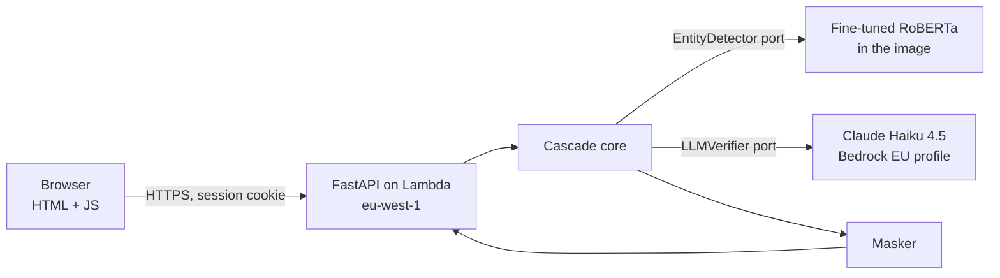
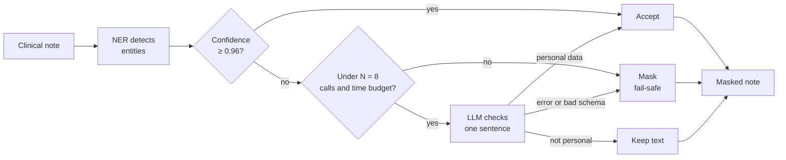
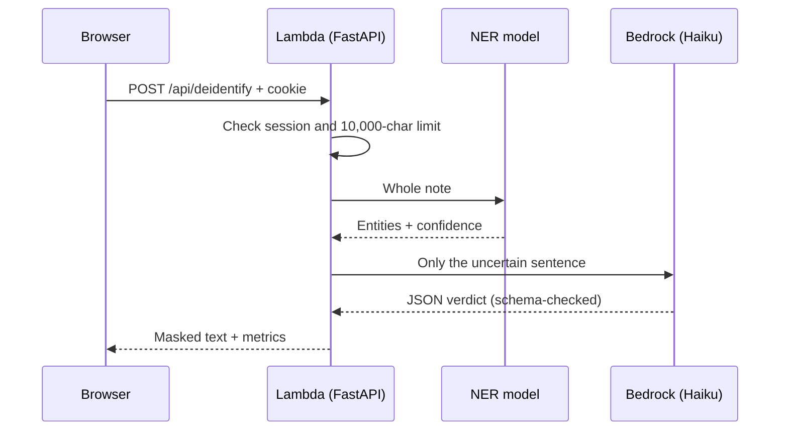
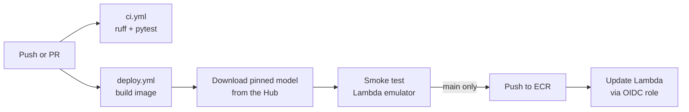

# Slide draft — Cascade clinical de-identification (T4.5)

> **Superseded** by the final deck in T5.2: [slides.md](slides.md) (rendered as `slides.pdf`).
> Kept as the planning record.

Draft for T5.2: structure, key points, speaker notes and diagrams. Target: about 12 slides and
about 10 minutes. Figures come from `src/clinical_deid/api/report/`. Cascade and LLM-only figures
are still pending (Bedrock access), so their slots are marked **TBD**.

---

## 1 · Title

- De-identifying Spanish clinical notes with a cascade: in-house NER + LLM only when in doubt
- Final project, Master's in AI-Assisted Development (BIG school) · Nov 2026
- Links: live demo · repository · model on the Hugging Face Hub

> Notes: one sentence on the idea. A small model does most of the work; a large model sees only the
> sentences the small model is unsure about.

## 2 · The problem

- Clinical notes are full of personal data: names, dates, places, IDs, contacts
- Sharing them for research or for AI tools requires de-identification first
- Manual review is slow; rules miss context; sending whole notes to an LLM leaks the whole note
- Goal: high recall, minimal data leaving the system, low cost per note

> Notes: recall matters most: a missed name is a leak; an extra mask only costs readability.

## 3 · Data: MEDDOCAN

- Spanish clinical case reports with **synthetic** personal data (Marimon et al., 2019), CC BY 4.0
- 22 entity types grouped into 8 categories: NAME, DATE, LOCATION, ID, CONTACT, AGE, PROFESSION, OTHER
- Standard train / dev / test split; the threshold is chosen on dev, the reported figures are on test
- Plus 5 hand-written synthetic notes in other styles (progress note, abbreviations, discharge report)

> Notes: no real patient data anywhere in the project.

## 4 · Architecture

- Ports and adapters: the core imports no Hugging Face, Bedrock or FastAPI code (ADR-0002)
- Tests use fakes: no network, no model download, no cost
- Spec Driven Development: requirements → design → tasks, decisions recorded as ADRs

## 5 · The cascade

- Confidence = mean token probability of the entity
- Threshold and N chosen once on dev (ADR-0009)
- Every failure path ends in **mask**, never in leaking the text

## 6 · One request, step by step

> Notes: the document never leaves Lambda; at most N single sentences go to Bedrock.

## 7 · Results

| Configuration | Recall | Precision | F1 | p50 latency | USD / note |
| --- | --- | --- | --- | --- | --- |
| Model only | 0.896 | 0.881 | 0.888 | 1.36 s | 0 |
| Cascade | TBD | TBD | TBD | TBD | TBD |
| LLM only (whole document) | TBD | TBD | TBD | TBD | TBD |

- MEDDOCAN test, 250 documents, strict span + category, micro-averaged
- Weakest categories for the model alone: ID (0.72) and PROFESSION (0.78)
- The same table is shown in the app's Comparison tab

> Notes: be explicit that model-only recall is just below the 0.90 target (AC-02). The cascade is meant
> to close that gap.

## 8 · Privacy by design

- User text is never stored or logged: logs hold counts and latency only (tested)
- Only one sentence per uncertain entity goes to the LLM, never the document
- Bedrock: EU inference profile; prompts are not stored or used for training
- Accepted limit: a sentence with personal data still reaches a third party; it is a conscious trade-off

## 9 · Security (OWASP)

| Risk | Control |
| --- | --- |
| LLM01 Prompt injection | Sentence delimited as data, fixed prompt, LLM only confirms or rejects |
| Improper output handling | Strict schema; anything else → mask |
| LLM10 Unbounded consumption | 10,000 chars, N ≤ 20 calls, time budget, timeouts, budget alerts; reserved concurrency TBD (#26) |
| XSS | `textContent` only, strict CSP |
| Authentication | argon2 hash, `HttpOnly`/`Secure`/`SameSite=Strict` cookie, lockout |
| Supply chain | Lockfile with hashes, pinned model revision, safetensors, SHA-pinned actions, Dependabot |

- The security review found that the deploy smoke test was blocking every release; now fixed and tested
  (`docs/security-review.md`)

## 10 · Deployment and CI/CD

- Lambda container image, 2,048 MB, 120 s timeout, Function URL, `eu-west-1`
- No long-lived AWS keys: GitHub OIDC with a least-privilege role
- Cost: AWS Budgets alerts at 50 % and 80 % of €50

## 11 · Limitations

- MEDDOCAN uses synthetic personal data in case reports; real notes will likely score lower
- Single demo account; sessions cannot be revoked server-side; per-instance lockout counters
- Uncertain sentences reach a third-party LLM
- Spanish only; trained on a single corpus

## 12 · Future work

- Evaluate on real, consented, de-identified-by-hand notes
- Calibrate confidence (for example temperature scaling) instead of mean token probability
- Self-hosted LLM to keep every sentence inside the account
- Server-side session store and a shared rate limiter if the tool goes beyond a demo

## 13 · Attribution and thanks

- Data: MEDDOCAN corpus, Marimon et al. (2019), licensed CC BY 4.0
- Base model: `BSC-LT/roberta-base-biomedical-clinical-es`
- Code licence: see `LICENSE` (TBD: align with design §12) · links to the demo, the repository and the video
