<!-- _class: cover -->
<!-- _paginate: false -->

# De-identifying Spanish clinical notes

A cascade: an in-house NER model, plus an LLM only when in doubt.

- **Final project (TFM)** · Master's in AI-Assisted Development · November 2026
- **Live demo** · kr4wgpmvqlswvvyauj7tazz5tu0sayjq.lambda-url.eu-west-1.on.aws
- **Code** · github.com/agustinroviraquezada/clinical-deid-es
- **Model** · huggingface.co/ahrovira/clinical-deid-es-meddocan

<!--
One sentence: a small model does most of the work inside the service; a large model sees only the sentences the small model is unsure about.
-->

---

# The problem

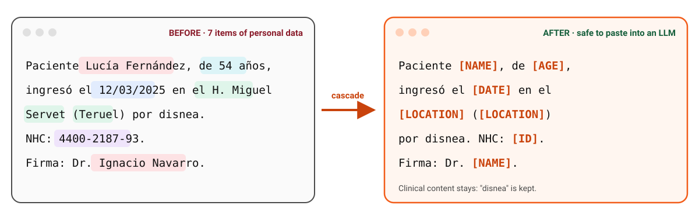

A note must lose its personal data before it goes into a general-purpose LLM. **Recall first**: a missed name is a leak.

<!--
Manual review is slow, rules miss context, and sending the whole note to an LLM to clean it leaks the whole note. Goal: high recall, minimal text leaving the system, low cost per note. All text on this slide is invented.
-->

---

# The solution: three steps, one note

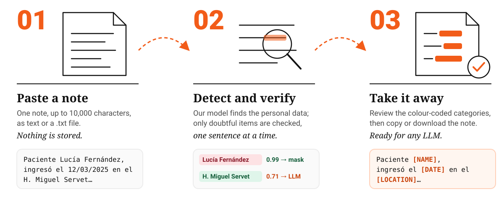

<!--
Tell it as the user lives it. 1: paste a note; it is processed in memory and never stored. 2: our fine-tuned model finds the personal data; whatever it is sure about is masked at once, and only the doubtful items go to an LLM, one sentence each. 3: the user reviews the colour-coded categories and copies or downloads the safe note. The confidence values on this slide are illustrative. Next: the data the model learned from, then each step opened up (architecture, design pattern, cascade).
-->

---

# Data: MEDDOCAN

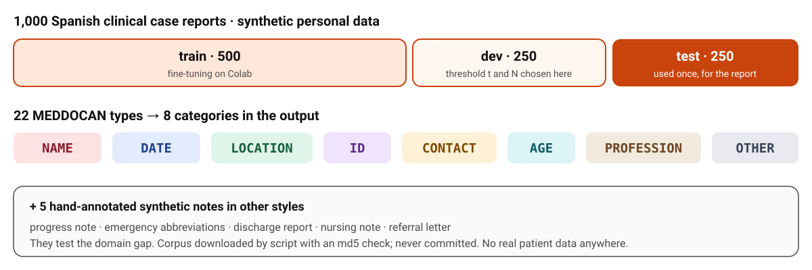

<!--
MEDDOCAN (Marimon et al., 2019), CC BY 4.0. The test split was used once, for the final report; the threshold was tuned on dev only.
-->

---

# Architecture

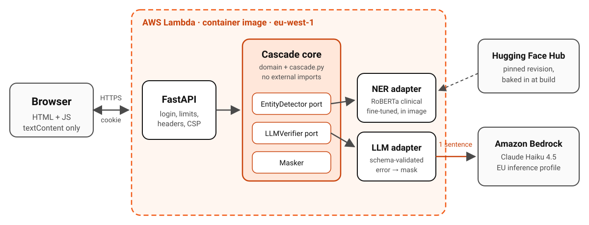

The note is processed inside one Lambda function; only uncertain sentences cross the boundary.

<!--
Model: BSC-LT/roberta-base-biomedical-clinical-es fine-tuned on Colab (T4 GPU, about 7 minutes). The model revision is pinned and baked into the image at build time.
-->

---

# Design pattern: ports and adapters (hexagonal)

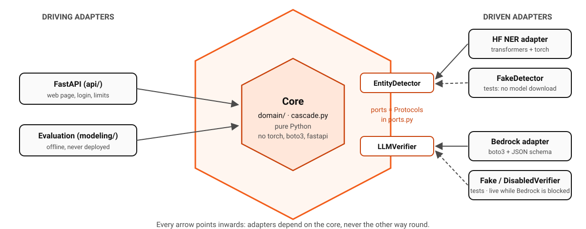

**Why:** the cascade is tested with fakes (no model, no AWS), and Bedrock can be switched off without touching the core.

<!--
ADR-0002, chosen over simple layers and over full Clean Architecture with DDD. Ports are Python Protocols (EntityDetector.detect, LLMVerifier.verify). Today the deployed service plugs in DisabledVerifier because Bedrock is blocked: same core, different adapter. modeling/ is offline code: it may import src/, never the other way round (ADR-0007).
-->

---

# The cascade

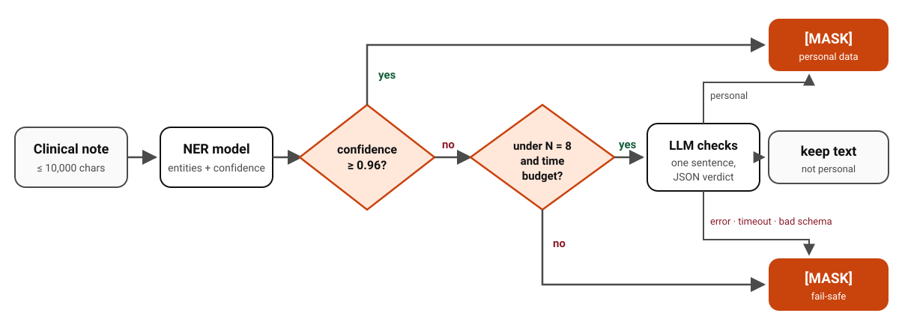

**t = 0.96** and **N = 8** chosen once on dev (ADR-0009). Every failure path ends in a mask.

<!--
Confidence = mean token probability of the entity. Rule for t: the upper edge of the highest confidence band whose precision is below 0.85. On dev every band below 0.96 has precision 0.04-0.79 and every band from 0.96 has 0.87-0.99. N = 8 is the 95th percentile of uncertain entities per document (17 % of entities are uncertain).
-->

---

# Results: model only

MEDDOCAN test · 250 documents · 5,661 entities · strict span + category

| Configuration | Recall | Precision | F1 | Latency p50 | USD / note |
| --- | --- | --- | --- | --- | --- |
| Model only, token level (seqeval) | 0.974 | 0.965 | 0.969 | | |
| **Model only, character level** | **0.896** | 0.881 | 0.888 | 1.36 s | 0 |
| Cascade | pending | pending | pending | pending | pending |
| LLM only (whole document) | pending | pending | pending | pending | pending |

Weakest: **ID 0.72** and **PROFESSION 0.78** recall · other styles: **F1 0.70** · Lambda: 0.1 s warm, 9 s cold

<!--
Character level is what the product masks; token level is the usual MEDDOCAN metric. Character-level recall is just below the 0.90 target: accepted as a limitation on 25 Nov. The cascade was designed to close that gap, but its figures are pending (next slide).
-->

---

# Results: why the LLM rows are pending

| Piece | Built | Tested with fakes | Running live | Measured |
| --- | :---: | :---: | :---: | :---: |
| NER model | ✅ | ✅ | ✅ | ✅ |
| Cascade: threshold, N cap, time budget | ✅ | ✅ | ✅ | ✅ (model only) |
| Bedrock adapter + JSON schema | ✅ | ✅ | ❌ | ❌ |
| Cascade and LLM-only evaluation | ✅ | ✅ | ❌ | **pending** |

**Bedrock is blocked at AWS account level** ("Error 002", every model). Support case open since 25 Nov.

<!--
Root and IAM users get the same error, so it is not a permissions problem. The deployed tool runs model only: uncertain entities are masked directly, which is the fail-safe path. One command runs the missing rows when access arrives: compare.py --configs cascade llm_only. Estimated LLM cost: 1 to 2 USD.
-->

---

# Privacy by design

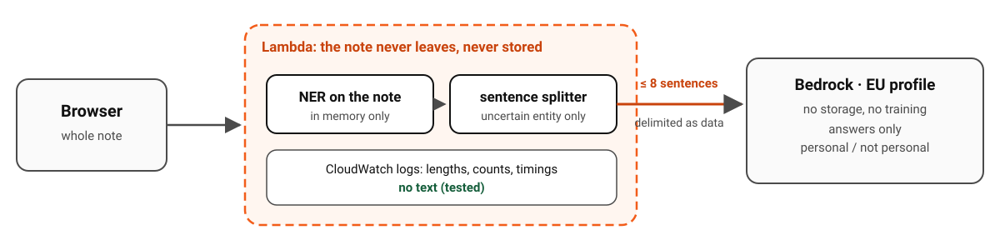

Accepted trade-off: an uncertain sentence still reaches a third party. It is one sentence, never the note.

---

# Security (OWASP Web and LLM)

| Risk | Control |
| --- | --- |
| LLM01 Prompt injection | Sentence delimited as data, fixed prompt, LLM can only confirm or reject |
| LLM05 Improper output handling | Strict JSON schema; anything else masks the entity |
| LLM10 Unbounded consumption | 10,000 chars, N ≤ 8 (hard cap 20), time budget, timeouts, budget alerts |
| XSS | `textContent` only, strict CSP and security headers |
| Authentication | argon2 hash, signed `HttpOnly` / `Secure` / `SameSite=Strict` cookie, 5 tries / 15 min |
| Supply chain | Lockfile, pinned model revision, safetensors, SHA-pinned actions, Dependabot |

---

# Deployment and CI/CD

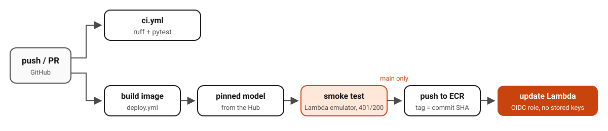

Lambda container · 2,048 MB · `eu-west-1` · **no long-lived AWS keys** · AWS Budgets alerts at 50 % and 80 % of €50

---

# AI-assisted development: from idea to spec

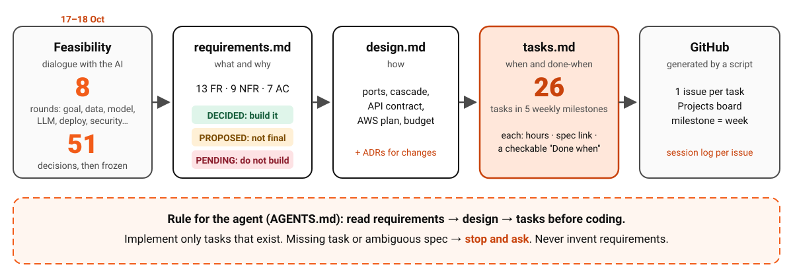

<!--
Spec Driven Development. The feasibility report was itself a structured dialogue with the AI, in 8 rounds; once frozen it became the three specs. The status legend tells the agent what it may build. The GitHub backlog is generated from tasks.md by a script, so plan and board never drift.
-->

---

# AI-assisted development: a task is a contract

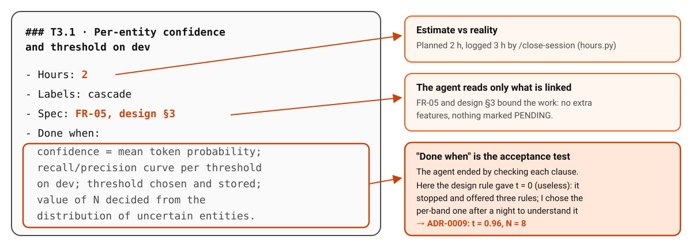

<!--
Real task from specs/tasks.md. The agent's /implement-task skill reads the task, then only the sections it links, and presents a plan in under 15 lines before any code. "Done when" is checked clause by clause at the end.
-->

---

# AI-assisted development: ADRs steer change

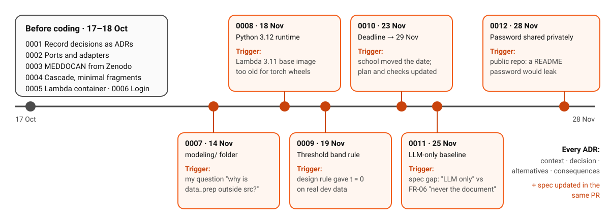

Six decisions before coding; six forced by reality. None was changed silently.

<!--
The rule in AGENTS.md: a scope or architecture change needs a new ADR plus a spec update. That made the agent stop instead of improvising when reality disagreed with the design (t = 0, Python 3.11, the LLM-only baseline).
-->

---

# AI-assisted workflow: one session per task

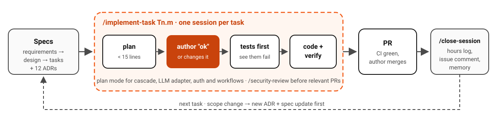

22 tasks · 25 sessions · 50 merged PRs · 450+ tests · 12 ADRs · 43 hours logged

<!--
AGENTS.md and CLAUDE.md hold the rules; skills encode the routine (/implement-task, /close-session, /security-review); path rules apply to tests, frontend, infra and notebooks. Permissions: push, PRs, aws and spec edits ask first; .env and ~/.aws cannot be read by the agent. Memory between sessions carries settled decisions.
-->

---

# AI-assisted development: how I learned to work with it

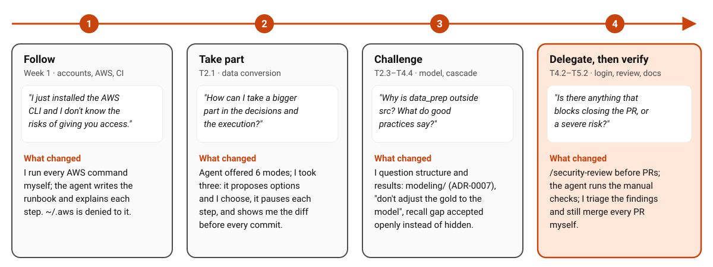

<!--
Quotes are my own requests from the sessions, translated. The pattern: from following instructions, to choosing how to take part, to challenging the agent, to delegating checks while keeping the merge.
-->

---

# AI-assisted development: what was caught, and by whom

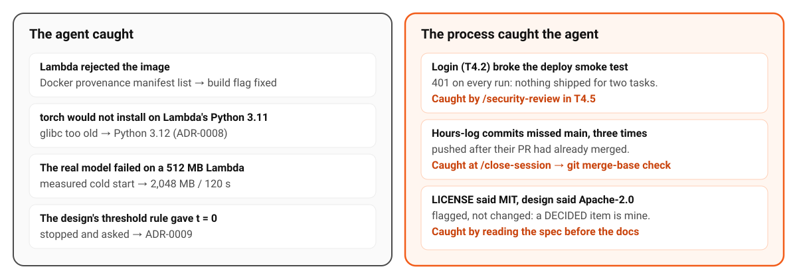

<!--
The most useful finding: the login added in T4.2 made the deploy smoke test return 401, so T4.2 and T4.3 never reached Lambda. The security review in T4.5 found it; the smoke test now checks 401 without a cookie and 200 with one.
-->

---

<!-- _class: takeaway -->

# AI-assisted development: takeaways

**Specs are the contract.** The agent builds what is written and stops when it is not.

**Approve plans, not diffs.** Fifteen lines of plan are cheaper to review than a pull request.

**Keep the irreversible steps.** AWS commands, merges and DECIDED items stayed with me.

---

# Limitations

| Limitation | Mitigation |
| --- | --- |
| Synthetic data in case reports; F1 0.70 on other styles | Synthetic notes show the gap; not for real patient data |
| Character-level recall 0.896, below 0.90 | Documented; ID and PROFESSION are the weak spots |
| LLM step not live and not measured | Fail-safe masking; evaluation ready to run |
| Uncertain sentences reach a third party | One sentence only, EU profile, no retention |
| No reserved concurrency (account quota 10) | Login, attempt limit, budget alerts |

**Not a certified system: do not use it on real patient data.**

---

# Future work

1. Run the cascade and LLM-only evaluation once Bedrock is unblocked
2. Close the recall gap: span boundary fixes, calibrated confidence
3. Evaluate on real, consented notes de-identified by hand
4. Self-hosted LLM, so no sentence leaves the account
5. Server-side sessions and a shared rate limiter beyond the demo

---

<!-- _class: lead -->

# Thank you

**Data:** MEDDOCAN corpus (Barcelona Supercomputing Center, CNIO, Hospital 12 de Octubre; Plan TL). Marimon et al., *Automatic De-identification of Medical Texts in Spanish: the MEDDOCAN Track*, IberLEF@SEPLN 2019. Licensed **CC BY 4.0**. doi:10.5281/zenodo.4279323

**Base model:** `BSC-LT/roberta-base-biomedical-clinical-es` (Apache-2.0) · **Code and fine-tuned model:** Apache-2.0

Academic project, not a certified system for real health data.
