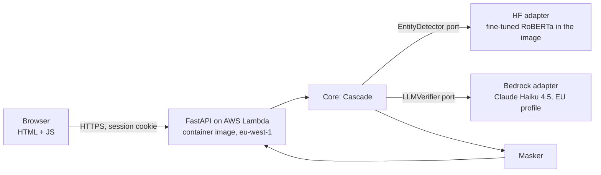

# Technical design

> Spec 2 of 3 (SDD). Derived from `requirements.md`. Every relevant decision has an ADR in `docs/adr/`.
> Legend: **DECIDED** · **PROPOSED** · **PENDING**.

## 1. Overview



## 2. Software architecture (DECIDED: lightweight ports and adapters — ADR-0002)

The core knows nothing about Hugging Face, Bedrock or FastAPI: it depends on two interfaces.

```
src/clinical_deid/
├── domain/             # No external dependencies
│   ├── entities.py     # Entity(start, end, type, category, text, confidence), Document
│   ├── categories.py   # MEDDOCAN type → grouped category mapping (FR-04)
│   └── masker.py       # Replaces spans with [CATEGORY] (FR-03)
├── ports.py            # EntityDetector and LLMVerifier protocols
├── cascade.py          # Use case: detect → filter uncertain → verify → mask
├── adapters/
│   ├── hf_ner.py       # EntityDetector with transformers (configurable model, FR-02)
│   ├── bedrock_llm.py  # LLMVerifier with boto3 + schema validation
│   └── fakes.py        # Test doubles (tests with no network and no cost)
├── api/
│   ├── app.py          # FastAPI: routes, limits, security headers
│   ├── auth.py         # Demo login (FR-08)
│   ├── schemas.py      # Pydantic: request/response
│   └── static/         # index.html, app.js, styles.css
├── config.py           # Validated settings (pydantic-settings) from environment variables
└── lambda_handler.py   # ASGI → Lambda adapter
data_prep/ (code, not data)
├── brat_to_bio.py      # MEDDOCAN BRAT → BIO converter (ADR-0003)
└── download_meddocan.py
evaluation/
├── evaluate.py         # 3 configurations → JSON + Markdown report
└── report/             # Precomputed results consumed by the Comparison tab
notebooks/
└── train_colab.ipynb   # Clones the repo and calls code from src/ and data_prep/
```

**Dependency rule:** `domain` ← `cascade` ← `adapters` / `api`. Never the other way round.

### Ports

```python
class EntityDetector(Protocol):
    def detect(self, text: str) -> list[Entity]: ...  # confidence in [0, 1]


class LLMVerifier(Protocol):
    def verify(self, sentence: str, entity: Entity) -> Verdict: ...

    # Verdict = {is_personal_data: bool, category: Category}
```

## 3. Cascade (DECIDED — ADR-0004)

1. `EntityDetector.detect(text)` → entities with confidence = **mean of their token probabilities**.
2. Entities with confidence ≥ threshold → accepted.
3. Entities with confidence < threshold → their **sentence** is extracted (sentence segmentation) and `LLMVerifier` is called, at most **N** times per document (FR-07). Entities beyond N are masked by default.
4. If the LLM fails (timeout, error, response outside the schema) → the entity **is masked** (fail-safe).
5. `Masker` replaces the accepted spans with `[CATEGORY]`.

- **Threshold:** chosen once on dev — the one that maximises recall with precision ≥ 0.85. Stored in configuration.
- **N:** PENDING (week 3, from the distribution of uncertain entities on dev).

## 4. LLM (DECIDED)

- Amazon Bedrock, `eu.anthropic.claude-haiku-4-5-20251001-v1:0` (EU profile). Requires the one-time Anthropic use-case form.
- Fixed system prompt; the sentence is **delimited** as data, never as an instruction.
- Structured output validated with Pydantic: `{"is_personal_data": bool, "category": "<one of the categories>"}`. Anything else → fail-safe.
- `temperature=0`, low `max_tokens`, timeout per call.
- Credentials: the Lambda function's IAM role (no keys in code or variables).

## 5. Model (DECIDED)

- Base: `BSC-LT/roberta-base-biomedical-clinical-es`, **pinned revision**, configurable name.
- Token-classification fine-tuning (BIO, original MEDDOCAN types) with `transformers.Trainer` on Colab. At most 3 runs. Checkpoints on Drive or the Hub.
- Weights converted to **safetensors**; published on the Hugging Face Hub (private during development) with a model card citing MEDDOCAN. Licence Apache-2.0.
- Metrics with `seqeval` (span + type) and per-category breakdown.

## 6. API (PROPOSED in detail; functional contract DECIDED)

| Method | Route | Auth | Description |
| --- | --- | --- | --- |
| GET | `/` | No | Page (login or app) |
| POST | `/api/login` | No | Username + password → signed session cookie. Attempt limit |
| POST | `/api/logout` | Yes | Ends the session |
| POST | `/api/deidentify` | Yes | `{text}` → `{deidentified_text, entities:[{start,end,category,source}], metrics:{latency_ms, n_entities, n_llm}}` |
| GET | `/api/comparison` | Yes | Precomputed results (FR-11) |
| GET | `/api/health` | No | Status (no data) |

Errors: 400 validation, 401 no session, 413 text > 10,000 characters, 429 limit, 503 LLM unavailable (with a degraded result when possible).

## 7. Demo login (DECIDED — ADR-0006)

- One account. Password stored as a **hash** (argon2 or bcrypt) in a Lambda environment variable; never in the repo.
- Session: `HttpOnly`, `Secure`, `SameSite=Strict`, signed cookie with a short lifetime.
- Login attempt limit; generic response on wrong credentials.
- Note: Lambda may run several instances, so in-memory counters are approximate. Accepted as a demo limitation.

## 8. Security (DECIDED — OWASP mapping)

| Risk | Control | Where | Test |
| --- | --- | --- | --- |
| LLM01 Prompt injection | Delimited sentence; LLM only confirms/rejects; schema-validated output | `bedrock_llm.py` | Malicious sentences with the test double and the real validator |
| Improper output handling | LLM output is never executed or inserted as HTML | `cascade.py`, `app.js` | Out-of-schema response → fail-safe |
| LLM10 Unbounded consumption | Reserved concurrency, 10,000 characters, N sentences, timeout, Budgets | Lambda, `app.py` | 413 and N cap |
| XSS | `textContent`, never `innerHTML`; CSP | `app.js`, headers | Text containing `<script>` comes out escaped |
| Authentication | Hash, secure cookie, attempt limit | `auth.py` | Login, 401, lockout |
| Supply chain | Dependabot, pinned model revision, safetensors, lockfile | repo, Dockerfile | CI |
| Privacy | No text in logs or storage | `app.py`, logging | Test that inspects the logs |

## 9. Deployment (DECIDED — ADR-0005)

- **Lambda with a container image** (ECR), Function URL, `eu-west-1`.
  - Development: URL auth `AWS_IAM` (closed). From submission: `NONE` + the app's login.
- **CI/CD (GitHub Actions):**
  1. `ci.yml` (every push/PR): ruff + pytest with test doubles (no network, no cost).
  2. `deploy.yml` (push to `main` or manual): **OIDC** authentication with an IAM role → download the model from the Hub (pinned revision, `HF_TOKEN` in GitHub secrets) → `docker build` → push to ECR → `aws lambda update-function-code`.
  - Fallback if OIDC causes problems: access keys in GitHub secrets.
- **Lambda memory:** PROPOSED 3,008 MB (tune after measuring); check the new account's quota.
- **Cost:** AWS Budgets with alerts at 50 % and 80 % of €50.
- **Lifecycle:** access closed during development; opened on 20 Nov; function, image and role deleted after the grade.

## 10. Configuration (environment variables)

| Variable | Example | Secret |
| --- | --- | --- |
| `MODEL_PATH` | `/opt/model` | No |
| `CONFIDENCE_THRESHOLD` | `0.85` (provisional) | No |
| `MAX_LLM_SENTENCES` | `10` (provisional) | No |
| `MAX_CHARACTERS` | `10000` | No |
| `BEDROCK_MODEL_ID` | `eu.anthropic.claude-haiku-4-5-20251001-v1:0` | No |
| `AWS_REGION` | `eu-west-1` | No |
| `DEMO_USERNAME` | `demo` | No |
| `DEMO_PASSWORD_HASH` | `$argon2id$…` | Yes |
| `SESSION_SECRET` | random | Yes |
| `LLM_ENABLED` | `true` | No |

## 11. Stack (DECIDED unless stated)

Python 3.11 · uv · FastAPI · Pydantic · transformers + PyTorch (CPU at inference) · seqeval ·
boto3 · Mangum (PROPOSED, ASGI→Lambda adapter) · pytest · ruff · pre-commit · Docker ·
GitHub Actions · AWS Lambda, ECR, IAM, Bedrock, Budgets · Hugging Face Hub · Colab.

## 12. Licensing (DECIDED)

- Code: Apache-2.0 (`LICENSE`, attributions in `NOTICE`).
- Fine-tuned model: Apache-2.0, model card citing MEDDOCAN (CC BY 4.0) and the base model (Apache-2.0).
- MEDDOCAN is not redistributed: it is downloaded by script.
