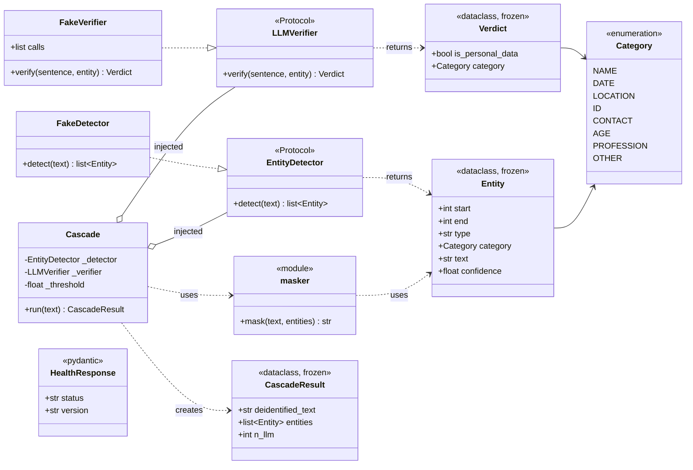
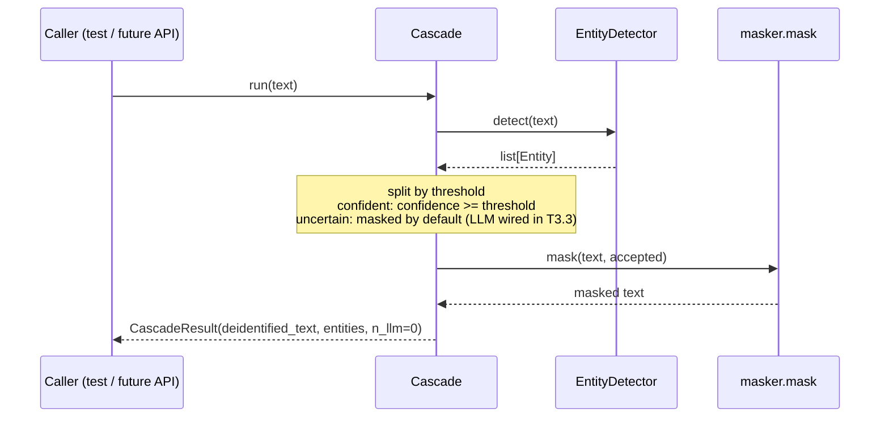

# `clinical_deid` package

Cascade de-identification of Spanish clinical notes. The package follows a lightweight
**ports and adapters** (hexagonal) architecture — see [ADR-0002](../../docs/adr/0002-ports-and-adapters-architecture.md)
and `specs/design.md` §2.

## Layout

| Module | Role | May import |
| --- | --- | --- |
| [`domain/`](domain/README.md) | Value objects, categories, masking. Pure Python. | standard library only |
| `ports.py` | Interfaces (protocols) the core needs from the outside world. | `domain` |
| `cascade.py` | Use case: detect → filter uncertain → verify → mask. | `domain`, `ports` |
| [`adapters/`](adapters/README.md) | Implementations of the ports (test doubles today; Hugging Face and Bedrock later). | `domain`, `ports`, external SDKs |
| [`api/`](api/README.md) | HTTP layer (FastAPI). | everything above, `fastapi` |

**Dependency rule:** `domain` ← `ports` ← `cascade` ← `adapters` / `api`. Arrows never point
outwards: the core never imports FastAPI, transformers, torch, boto3 or httpx.
`tests/test_architecture.py` enforces this.

## Class diagram (state after T1.3)

Future adapters (`HfEntityDetector` in T2.6, `BedrockVerifier` in T3.2) will implement the same
two protocols, so `Cascade` does not change when they arrive.

## Request flow (T1.3)

## Design patterns

| Pattern | Where | Why |
| --- | --- | --- |
| Ports and adapters (hexagonal) | `ports.py` + `adapters/` | Swap the NER model or the LLM without touching the core; test without network. |
| Dependency injection (constructor) | `Cascade.__init__` | The caller decides which detector and verifier to use (real or fake). |
| Strategy | `EntityDetector`, `LLMVerifier` | Interchangeable algorithms behind one interface. |
| Structural typing (`typing.Protocol`) | `ports.py` | Adapters do not inherit from anything; matching method signatures is enough. |
| Use case / application service | `Cascade` | One class orchestrates one business operation. |
| Value object (immutable) | `Entity`, `Verdict`, `CascadeResult` | Frozen dataclasses: cannot be changed by accident once created. |
| Test double (stub + spy) | `FakeDetector`, `FakeVerifier` | Deterministic, free tests; `FakeVerifier.calls` records invocations. |
| DTO | `api/schemas.py` | Pydantic models define and validate the HTTP contract. |
